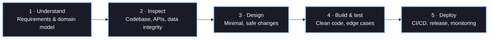
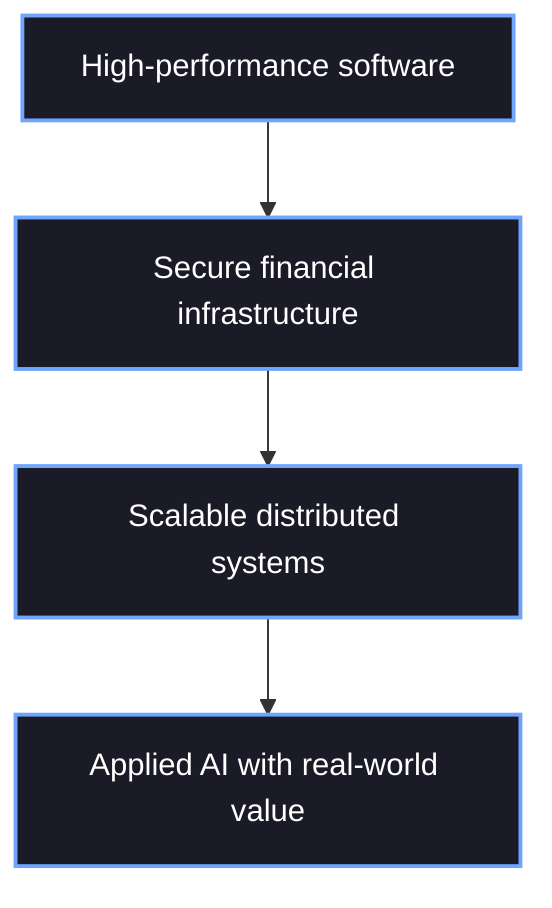

# Hi, I'm Sylvester Mutinda

### Full-Stack Developer • Software Engineer • IT Graduate • System Architect

**Building scalable software, integrating financial systems, and transforming complex real-world requirements into resilient digital solutions.**

 

---

## 🚀 About Me

I'm **Sylvester Mutinda**, an Information Technology graduate from the **Technical University of Kenya**, specializing in software engineering, full-stack web and mobile development, systems architecture, FinTech API integration, and applied AI automation.

I thrive across the full software lifecycle — from architectural planning and database schema design to building robust backends, crafting responsive interfaces, setting up automated CI/CD pipelines, and maintaining production deployments.

---

### 💡 Core Focus & Capabilities

- 🌐 **Full-Stack Web Architectures:** Next.js, React, Node.js, Laravel, and Flask REST APIs.
- 💳 **FinTech & Payments:** End-to-end Safaricom M-Pesa Daraja APIs, STK Push, Callbacks, and Reconciliation.
- 📱 **Mobile Development:** Native Android using Kotlin, offline caching, and REST communication.
- 🤖 **Applied AI & ML:** Computer vision models (MobileNetV2), semantic search, and context-aware LLM agents.
- 📩 **Messaging Platforms:** Automated SMS broadcasting, credit management, and webhook pipelines.
- 🏦 **Enterprise & Sacco Tech:** Governance dashboards, health diagnostic engines, and role-based access systems.

> *"Good software architecture turns complex domain logic into intuitive, predictable user experiences."*

---

# 📊 GitHub Analytics & Repository Metrics

 

## About me

I'm an Information Technology graduate from the **Technical University of Kenya**, building software at **Wakandi Kenya**. I work across the whole lifecycle: schema design, backends, responsive interfaces, CI/CD and production deployments.

- 💳 **FinTech & payments** — Safaricom M-Pesa Daraja, STK Push, callbacks and reconciliation
- 🌐 **Full-stack web** — Next.js, React, Node.js, Laravel and Flask REST APIs
- 📱 **Mobile** — native Android in Kotlin, with offline caching
- 🤖 **Applied AI** — computer vision (MobileNetV2), semantic search and LLM agents

> *"Good software architecture turns complex domain logic into intuitive, predictable user experiences."*

## Tech stack

  

## Featured projects

| Project | What it does | Stack |
| --- | --- | --- |
| 🏦 **[Muthurwa Market Stall Booking](https://github.com/MWANZIAMUTINDA/MUTHURWA_MARKET_SMART_STALL_BOOKING-SYSTEM)** | Real-time stall reservation with M-Pesa STK Push payments and admin dashboards | `Laravel` `MariaDB` `M-Pesa` |
| 🏙️ **[Geo-AI Garbage Detection](https://github.com/MWANZIAMUTINDA/nairobi_garbage_detection_system)** | Classifies illegal dumping from images and maps the sites | `Python` `MobileNetV2` `Flask` `Leaflet.js` |
| 🏦 **[SACCO Health Check](https://github.com/MWANZIAMUTINDA/SACCO-Health-Check-Automated-Financial-Diagnostic)** | 46-point diagnostic dashboard with plain-language executive summaries | `React` `TypeScript` `Tailwind CSS` |
| 📩 **Wakandi SMS & Member Management** | Bulk SMS broadcasting, top-ups and multi-role access for SACCOs | `Next.js` `Supabase` `Brevo` |
| 📱 **Beijing FC Management** | Android app for squad rosters, match availability and M-Pesa contributions | `Kotlin` `Laravel` `M-Pesa` |
| 🎫 **AI Ticket Duplicate Detection** | Flags duplicate support requests by semantic similarity before queue assignment | `TypeScript` `OpenAI API` `Node.js` |

## How I work

## GitHub activity

<b>Expertise in detail</b>

 

| Technical area | Primary stack & tools | Implementation highlights |
| --- | --- | --- |
| **Full-stack web** | Next.js, React, Laravel, Node.js | Responsive UI, Server Actions, REST APIs, RBAC |
| **Mobile engineering** | Kotlin, Android SDK, Retrofit | Offline state, secure token storage, live APIs |
| **Payment systems** | Safaricom Daraja, M-Pesa API | STK Push, callback webhooks, reconciliations |
| **AI & machine learning** | Python, MobileNetV2, Gemini, OpenAI | Computer vision, AI chatbots, knowledge bases |
| **Relational data** | PostgreSQL, MySQL, Supabase | Complex schema, stored procedures, indexing |
| **Systems security** | JWT, OAuth, role-based access | Webhook validation, environment security |

<b>Engineering objectives</b>

 

<b>Beyond code</b>

 

- ⚽ **Football & sports data** — match tactics and sports management analytics
- 👟 **Streetwear & sneakers** — Jordan colorways and cap pairings
- 📚 **Continuous learning** — distributed systems, AI agent frameworks and system optimization
- 🤝 **Community** — mentoring peer developers and contributing to open source

## Let's connect

I'm open to full-stack engineering roles, FinTech API integration projects and AI automation collaborations.

