  
  

I build software for the way money actually moves in Kenya: SACCOs, chamas and churches, M-Pesa, SMS, and the credit checks that come before a loan. IT graduate of the **Technical University of Kenya**, now at **Wakandi Kenya**.

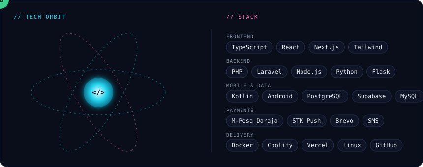


## Projects

| Project | What it does | Built with | Status |
| --- | --- | --- | --- |
| **CRB Lookup** · Wakandi | Credit-bureau checks for SACCOs, MFIs and chamas, with expiring results, an audit log and an API for loan products | Next.js, Supabase, PostgreSQL RLS | Shipped Oct 2026 |
| **M-Pesa SMS top-ups** · Wakandi | STK Push checkout per bundle, with payments recovered when the callback never comes | M-Pesa Daraja, Next.js, Supabase | Live |
| **Support chatbot** · Wakandi | Brevo chat that onboards new customers from a knowledge base | Brevo, TypeScript | Live |
| [**SOKA**](https://github.com/MWANZIAMUTINDA/soka-web) | Run your EA SPORTS FC friends' league | TypeScript, mobile, realtime | Sprint 1 |
| **Mandai** | Transparent car imports for Kenya | Next.js, TypeScript, payments | In progress |
| **Beijing FC** | Football club operations, with an Android app | Laravel, Kotlin, M-Pesa | Active |
| [**Kyeteni Pay**](https://github.com/MWANZIAMUTINDA/kyeteni-payment) | QR-code M-Pesa payments with receipts anyone can verify | Laravel, MySQL, Daraja | Live |
| [**SACCO Health Check**](https://github.com/MWANZIAMUTINDA/SACCO-Health-Check-Automated-Financial-Diagnostic) | A 46-point automated financial diagnostic | React, TypeScript, Tailwind | Demo |
| [**Nairobi Garbage Detection**](https://github.com/MWANZIAMUTINDA/nairobi_garbage_detection_system) | Report illegal dumping with a photo | Python, MobileNetV2, Flask | Open source |
| [**Muthurwa Smart Stalls**](https://github.com/MWANZIAMUTINDA/MUTHURWA_MARKET_SMART_STALL_BOOKING-SYSTEM) | Digital revenue collection for Muthurwa Market | Laravel, MariaDB, M-Pesa | Open source |

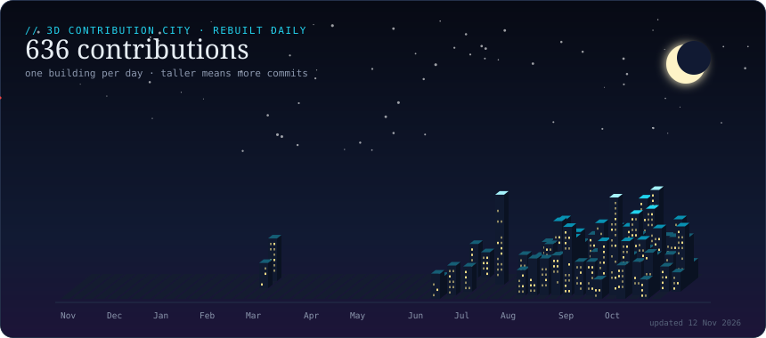

<b>How I build M-Pesa payments</b>

A payment isn't done when the STK Push is sent. It's done when the money is matched to the right record, even if Safaricom's callback never comes.

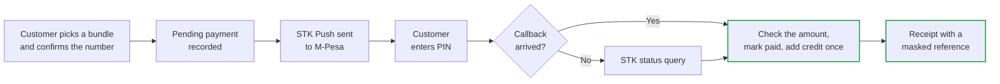


  <a href="https://github.com/MWANZIAMUTINDA">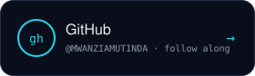</a>
  <a href="https://github.com/MWANZIAMUTINDA?tab=repositories">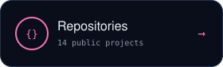</a>
  <a href="https://github.com/MWANZIAMUTINDA/soka-web">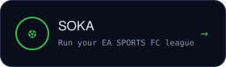</a>

