<!-- Header -->

  

  

  
  
  
  
  

---

## 👋 About me

I'm **Sylvester Mutinda**, a full-stack engineer at **Wakandi Kenya** and an IT graduate of the **Technical University of Kenya**. I build software for the way money actually moves in Kenya: SACCOs, chamas and churches, M-Pesa, SMS, and the credit checks that come before a loan.

I work across the whole stack, from database schema and row-level security to the screens people use on a phone, and I ship with tests: the Jamii platform I work on runs more than 2,000 of them on every change.

## 🔭 What I'm working on now · October 2026

- 🏦 **CRB Lookup at Wakandi.** "Check before you lend" for SACCOs, MFIs and chamas: credit checks inside a loan application, results that expire, a full audit log, and an API that loan products call with keys.
- 💳 **M-Pesa top-ups for Jamii Connect.** STK Push per bundle, confirming the number before the prompt, and recovering payments whose callback never arrived.
- 🤖 **Support chatbot and knowledge base.** A Brevo chat that onboards new customers, answering from a knowledge base written against the live app.
- ⚽ **SOKA**, my own app for EA SPORTS FC friends' leagues. Sprint 1 starts on 2 November 2026.
- 🚗 **Mandai**, a transparent car-import platform for Kenya.

---

## 🛠️ Featured work

### At Wakandi Kenya · the Jamii platform

  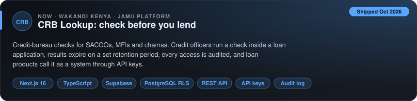

  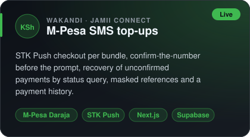
  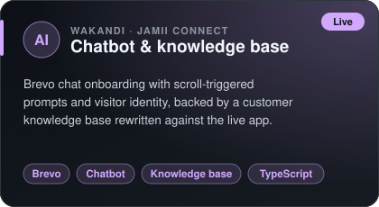

### Personal and client projects

  <a href="https://github.com/MWANZIAMUTINDA/soka-web">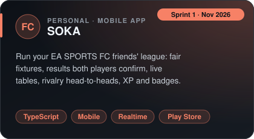</a>
  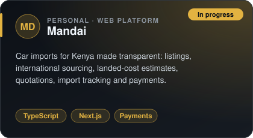

  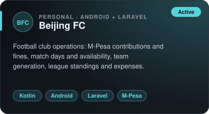
  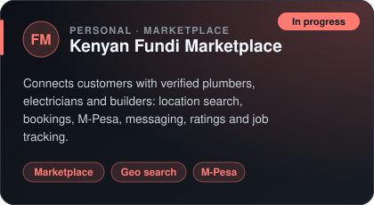

  <a href="https://github.com/MWANZIAMUTINDA/kyeteni-payment">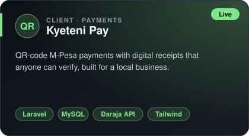</a>
  <a href="https://github.com/MWANZIAMUTINDA/SACCO-Health-Check-Automated-Financial-Diagnostic">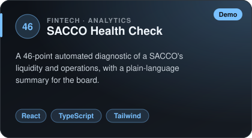</a>

  <a href="https://github.com/MWANZIAMUTINDA/nairobi_garbage_detection_system">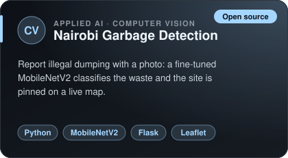</a>
  <a href="https://github.com/MWANZIAMUTINDA/MUTHURWA_MARKET_SMART_STALL_BOOKING-SYSTEM">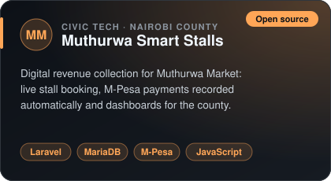</a>

---

## 📈 My year in numbers

**Contributions per month in 2026.** Most of my work is in private company repos, so the public graph shows less than this.

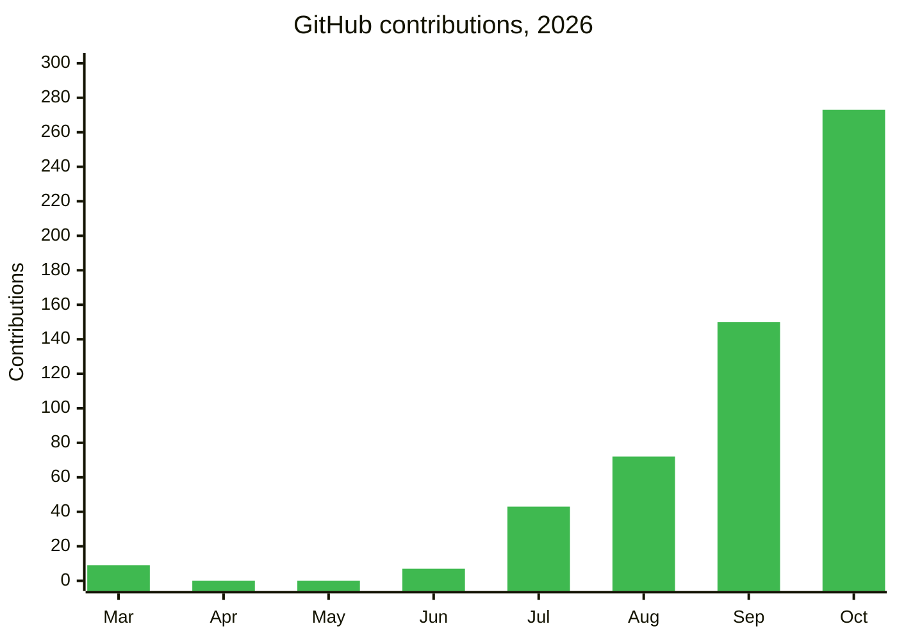

**Where my Jamii commits went, September to October 2026**

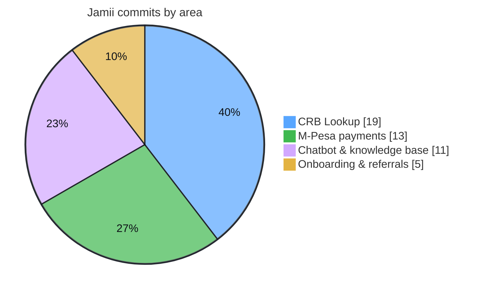

**How 2026 went**

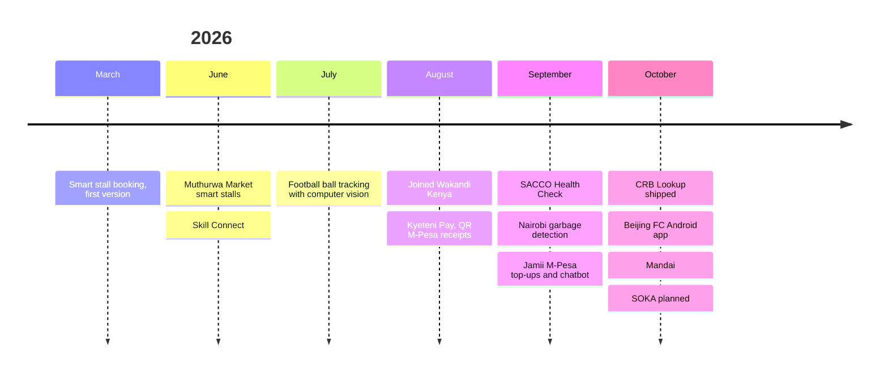

---

## 💳 How I build M-Pesa payments

A payment isn't done when the STK Push is sent. It's done when the money is matched to the right record, even if Safaricom's callback never comes.

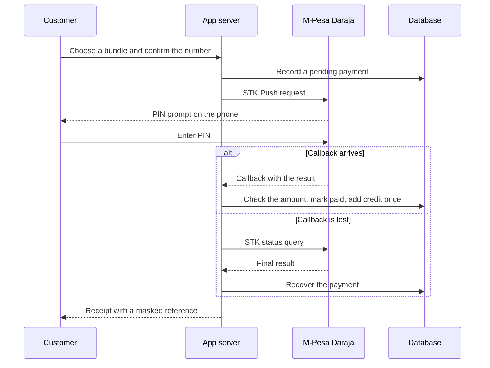

---

## 📊 GitHub stats

  
  

  
  

  

---

## 🧰 Tech stack

<b>Frontend</b>  
  

<b>Backend</b>  
  

<b>Mobile, data and AI</b>  
  

<b>Tools and delivery</b>  
  

  
  
  
  

---

## 🧭 How I work

| Step | What it means |
| --- | --- |
| **Understand** | Learn the domain first: how a SACCO lends, how a church collects giving, how a chama tracks contributions. |
| **Read before writing** | Check the existing code, data and patterns before adding anything new. |
| **Small, tested steps** | Small pull requests, each one with tests, and row-level security checked in the database itself. |
| **Ship and watch** | Deploy with Docker and Coolify, then check it works for real users. |

## ⚽ Beyond code

- ⚽ Football: I play, follow the tactics, and build tools for my club.
- 👟 Streetwear and sneakers: Jordans and caps.
- 📚 Learning: distributed systems and AI agents.

---

## 🤝 Let's work together

I'm open to full-stack, fintech and payments work, and applied AI projects. The fastest way to reach me is a message here on GitHub.

  

